# TP2-DAR2026 : Échange de chaînes et d'objets via les sockets TCP

**Nom :** Nour SAIDANI  
**Classe :** LSI 3  
**Matière :** Développement d'applications réparties

# Activité 2-1 : Échange de chaînes de caractères entre Client/Serveur

## Étape 1 : Préparation de l'espace de travail

Le projet `TP2-DAR2026` contient les packages `serverPackage` et `clientPackage`, le fichier `README.md` et le dossier `images`.

## Étape 2 : Application des flux de traitement de chaînes de caractères

### Code du serveur

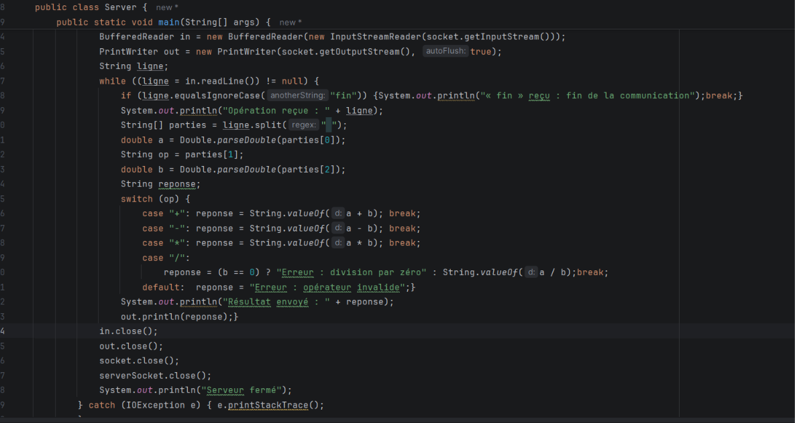

Le serveur attend un client, puis lit chaque ligne reçue avec `BufferedReader.readLine`. Il découpe la ligne avec `split(" ")` en trois éléments (premier opérande, opérateur, deuxième opérande), calcule avec un `switch` sur l'opérateur et renvoie le résultat avec `PrintWriter.println`. Il s'arrête quand il reçoit « fin ».

### Code du client

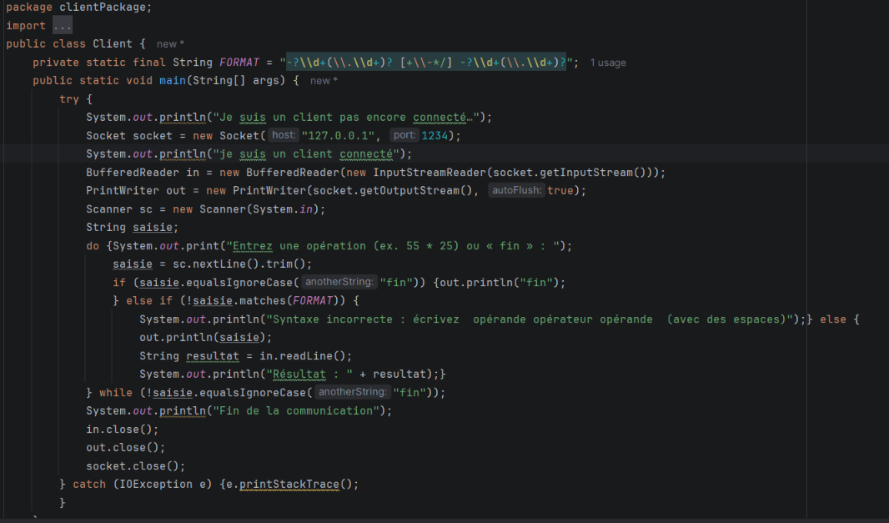

Le client lit au clavier une opération complète (par exemple `55 * 25`). Avant l'envoi, il vérifie la syntaxe avec une expression régulière. Si la syntaxe est correcte, il envoie la ligne au serveur avec `PrintWriter.println`, lit la réponse avec `BufferedReader.readLine` et l'affiche. La saisie de « fin » termine la communication.

### Tests

Console du client (opérations valides, division par zéro, puis `fin`) :

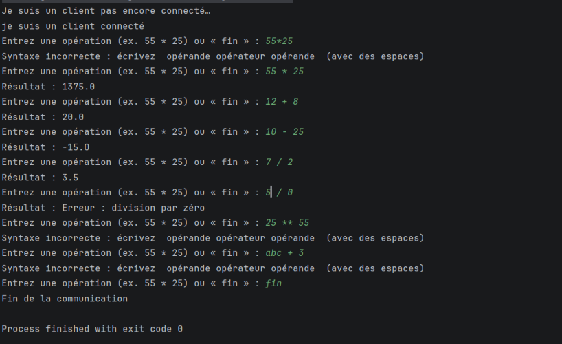

Console du serveur :

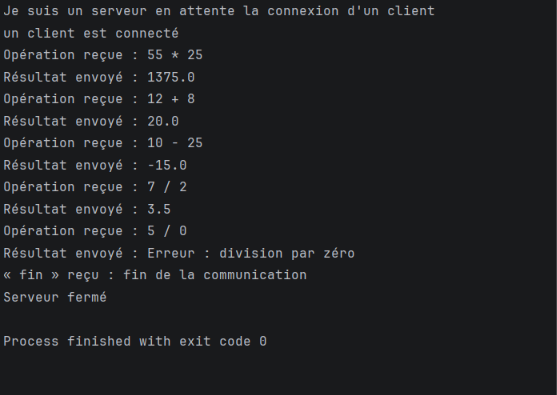

### Interprétation

- Dans l'Activité 1-2, `write` et `read` n'échangeaient qu'un seul octet : il était impossible d'envoyer une opération comme `55 * 25`. Ici, le client envoie une **ligne de texte** avec `PrintWriter.println` et le serveur la lit avec `BufferedReader.readLine`.
- `PrintWriter` est créé avec l'option d'envoi automatique : sans elle, la ligne resterait dans le tampon et le serveur attendrait sans fin.
- Le serveur découpe la ligne en trois éléments, calcule et renvoie le résultat sous forme de texte, que le client lit et affiche.
- Les résultats obtenus sont corrects : 55 * 25 = 1375.0, 12 + 8 = 20.0, 10 - 25 = -15.0 et 7 / 2 = 3.5. La division par zéro est détectée par le serveur, qui renvoie un message d'erreur.
- La syntaxe est validée **côté client** avant l'envoi : des chaînes comme `25 ** 55` ou `abc + 3` sont refusées et ne sont jamais transmises au serveur.
- La saisie de `fin` termine la communication : les deux applications ferment leurs flux et leurs sockets.

# Activité 2-2 : Échange d'objets entre Client/Serveur via les sockets TCP

## Étape 1 : Préparation de l'espace de travail

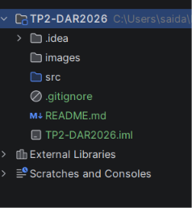
Le projet contient maintenant le package `commonPackage` (classe `Operation`), en plus de `serverPackage` et `clientPackage`.

## Étape 2 : Implémentation de l'échange d'objets

### a) Classe Operation (Serializable)

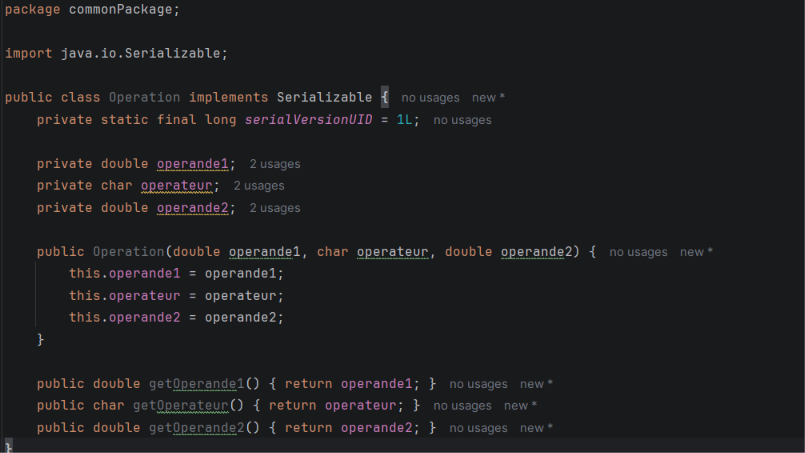

La classe `Operation` implémente l'interface `Serializable` : cela permet de transformer l'objet en suite d'octets pour le transmettre sur le réseau. Elle contient le premier opérande, l'opérateur et le deuxième opérande. Elle est placée dans un package commun, car le client et le serveur doivent connaître la même classe.

### b) Code du client

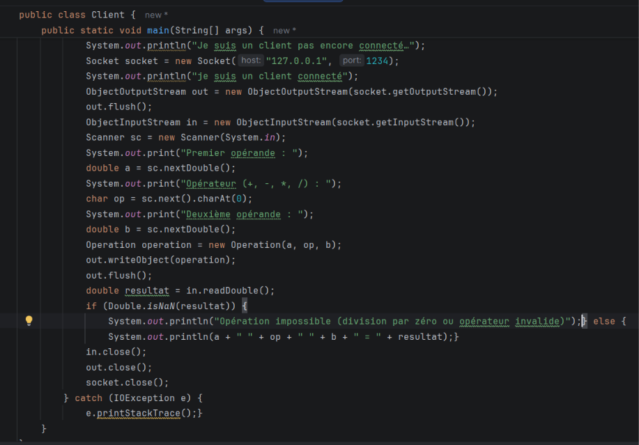

Le client lit au clavier les deux opérandes et l'opérateur, crée un objet `Operation` et l'envoie au serveur avec `ObjectOutputStream.writeObject`. Il lit ensuite le résultat avec `readDouble` et l'affiche.

### c à f) Code du serveur

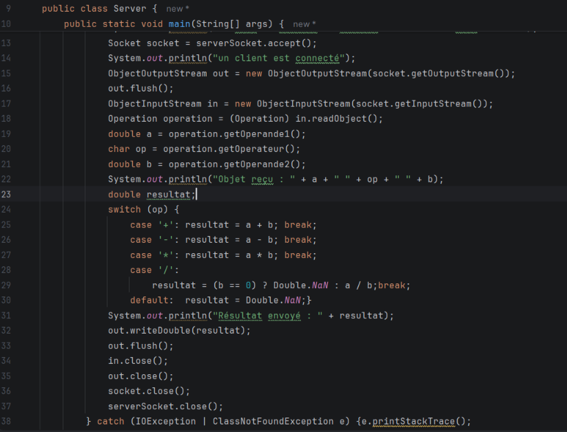

Le serveur reçoit l'objet avec `ObjectInputStream.readObject` et le convertit en `Operation` par un cast. Il récupère les trois valeurs avec les getters, effectue le calcul avec un `switch` sur l'opérateur et renvoie le résultat avec `writeDouble`.

### g) Tests

Addition 12 + 8 :

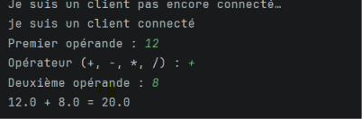

Division 7 / 2 :

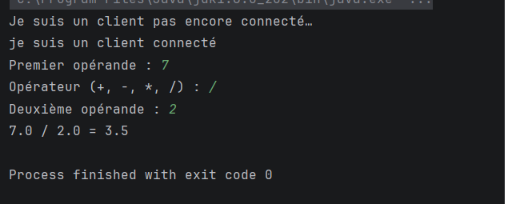

Multiplication -4 * 5 :

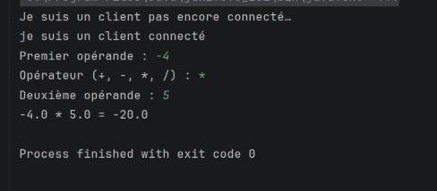)

Division par zéro :

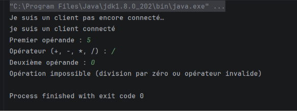

### Interprétation

- Le client envoie **un objet** et non plus une chaîne ou un entier : l'opération arrive au serveur sous forme structurée, sans qu'il ait besoin d'analyser un texte avec `split` comme dans l'Activité 2-1.
- Sans `Serializable`, l'envoi échouerait avec une `NotSerializableException`.
- Les résultats 20.0, 3.5 et -20.0 sont corrects. La division par zéro est détectée côté serveur, qui renvoie `NaN` : le client affiche alors « Opération impossible ».
- Chaque côté crée d'abord son `ObjectOutputStream` et le vide avec `flush()`, puis seulement son `ObjectInputStream` : cela évite un blocage mutuel à l'ouverture des flux.